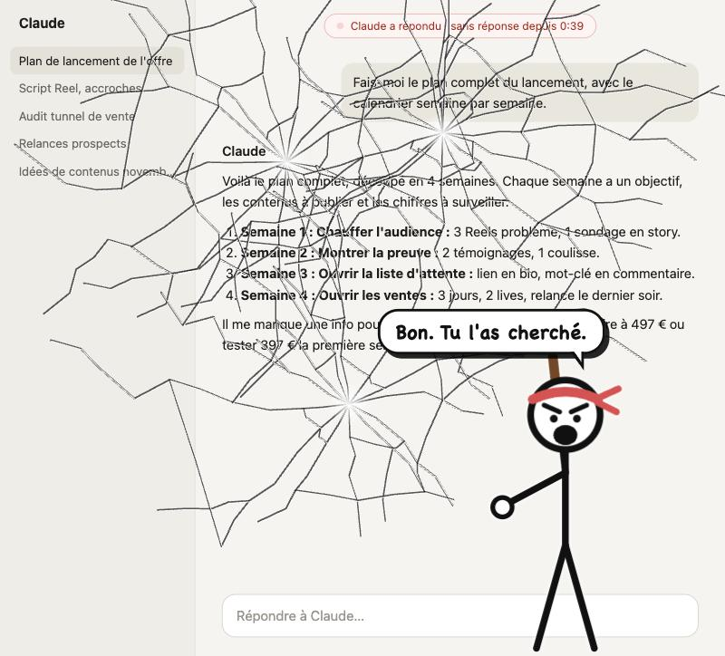
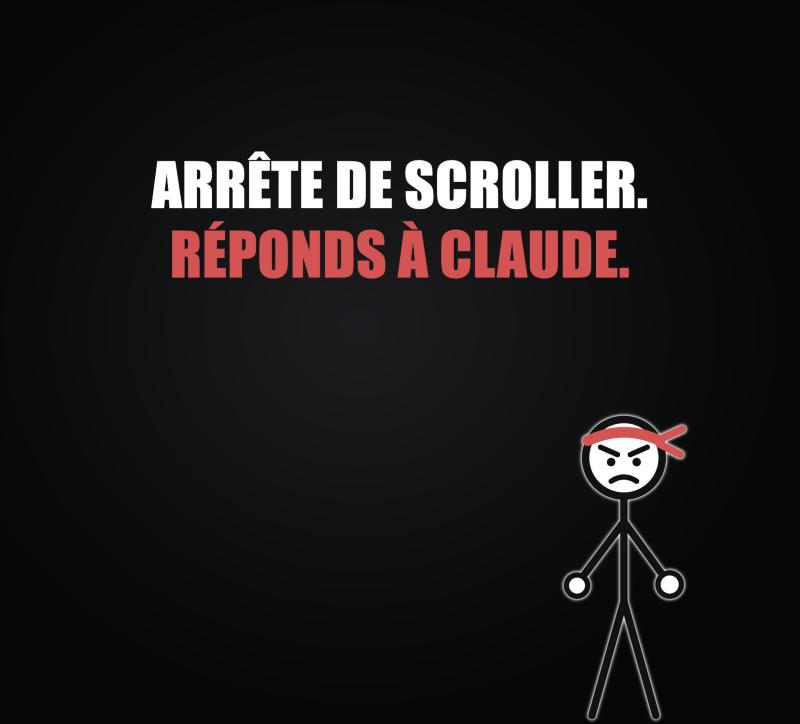

# Écran Cassé 🔨

Tu lances une tâche à Claude, tu prends ton téléphone… et Claude t'attend depuis 10 minutes.
Cinq minutes perdues, vingt fois par jour, ça fait des heures.

**Écran Cassé** règle ça : quand Claude a répondu et que tu n'as pas touché ton ordinateur depuis 30 secondes, un bonhomme débarque, tape à la vitre, frappe… puis casse ton écran à coups de masse. Il te dit d'arrêter de scroller et de répondre à Claude.

Bouge la souris : l'écran se répare tout seul.

<p align="center">
  
  
</p>

▶ **[Voir la démo dans ton navigateur](https://pablitooo5.github.io/ecran-casse/demo.html)** (avec le son, sans rien installer)

---

## Installer (Mac)

Ouvre l'app **Terminal** et colle cette ligne :

```bash
curl -fsSL https://raw.githubusercontent.com/Pablitooo5/ecran-casse/main/install.sh | bash
```

Ensuite, clique sur l'icône **🔨** dans la barre des menus, puis sur **Lancer la démo**.

**Il te faut :**
- un Mac avec macOS 14 (Sonoma) ou plus récent ;
- **Claude Code** : l'onglet *Code* de l'app Claude, ou Claude Code dans le terminal (l'onglet *Chat* classique ne prévient pas quand Claude a fini) ;
- les outils de développement d'Apple. S'ils manquent, l'installation te le dit ; lance alors `xcode-select --install` puis recommence.

## Le menu 🔨

- **Lancer la démo** : le spectacle complet, 3 secondes plus tard.
- **En pause** : rien ne se passe tant que c'est coché (pratique avant de partir déjeuner).
- **Son** : couper ou remettre les bruitages.
- **Casser l'écran après…** : 15 s, 30 s, 1 min ou 2 min.
- **Vrais morceaux d'écran : autoriser…** : par défaut, ce sont des éclats de verre gris qui tombent. Si tu autorises la capture d'écran dans *Réglages Système → Confidentialité et sécurité → Enregistrement de l'écran*, ce sont de vrais morceaux de ton écran qui tombent. L'image reste sur ton Mac et n'est jamais enregistrée ni envoyée.
- **Réparer l'écran maintenant** : arrête tout immédiatement.

## Comment ça marche

1. Des *hooks* Claude Code notent le moment où Claude finit une réponse, et l'effacent dès que tu réponds ou que Claude se remet au travail.
2. L'app regarde depuis combien de temps la souris et le clavier n'ont pas bougé.
3. Claude attend depuis 30 s **et** personne n'a touché l'ordinateur depuis 30 s : le bonhomme arrive. Il ne vient qu'une fois par réponse de Claude. Il te dit **quelle conversation** t'attend (son titre), et combien d'autres attendent aussi.
4. Dès que tu bouges, il répare l'écran et s'en va. Les clics traversent toujours ses dessins.

Rien n'est envoyé sur Internet. Tout tient dans `~/.claude/ecran-casse` et dans les hooks de `~/.claude/settings.json`. Une copie de tes réglages est gardée à côté (`settings.json.avant-ecran-casse.bak`).

## Désinstaller

```bash
~/.claude/ecran-casse/uninstall.sh
```

## À savoir

Projet perso et non officiel, sans lien avec Anthropic. « Claude » et « Claude Code » sont des marques d'Anthropic.
Licence MIT : tu peux le modifier et le partager librement.

Du même auteur : [Alerte Contexte](https://github.com/Pablitooo5/alerte-contexte), un chef de chantier qui passe avec une pancarte quand ta conversation Claude Code devient trop lourde.
